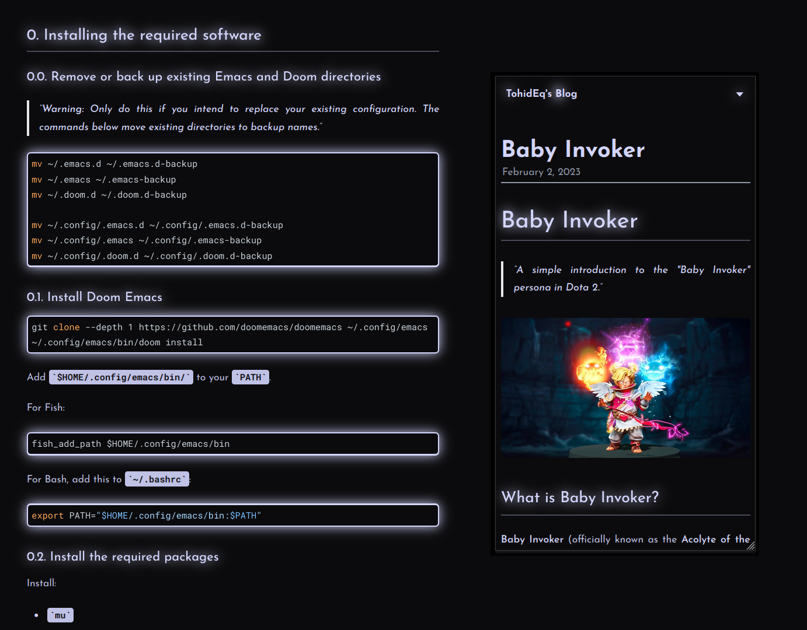

# TohidEq's Blog

## Preview



### Configuration
- Create your custom database github repo and fill it with mdx files
- Edit `./src/lib/posts.ts` and change url in line 17 to your custom repo url:

```js
    `https://raw.githubusercontent.com/YOUR_GITHUB_USERNAME_HERE/YOUR_REPO_NAME_HERE/YOUR_BRANCH_NAME_HERE/${fileName}`,
```

- Edit `./next.config.js` change line 9 too (for `Images`):

```js
        pathname: '/YOUR_GITHUB_USERNAME_HERE/YOUR_REPO_NAME_HERE/YOUR_BRANCH_NAME_HERE/YOUR_IMAGE_FOLDER_NAME_HERE/**'
```
- Create a github token with public repo access (to your `mdx-db-repo`)
- Create `.env.local` file (`SITE_URL` is Optional in local network)

> u can use `SITE_URL=YOUR_SITE_NAME` to deploy in vercel

```sh
SITE_URL=http://localhost:3000
MY_SECRET_TOKEN=randomstringhereanythingyouwant
GITHUB_TOKEN=your_github_token_access_to_public_repos_here
```
