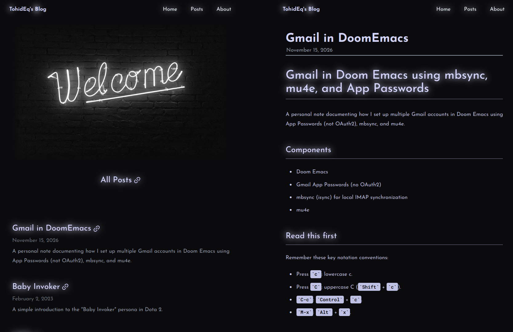

# TohidEq's Blog

A minimal, dark-themed personal blog built to share technical notes, tutorials, and things worth documenting.

**[Live Demo](https://tohideq-blog.vercel.app/)** · [Source Code](https://github.com/TohidEq/tohideq-blog) · [Posts Repository](https://github.com/TohidEq/tohideq-blog-posts-mdx)

## Preview




## Features

- MDX-based blog posts
- Separate content repository
- Syntax-highlighted code blocks
- Automatic heading anchors
- Custom image and video components
- Responsive layout
- SEO and sitemap generation

## Getting Started

### Prerequisites

Make sure you have the following installed:

- [Node.js 26.x](https://nodejs.org/)
- [Git](https://git-scm.com/)
- A [GitHub account](https://github.com/)

### 1. Clone the repository

```bash
git clone https://github.com/TohidEq/tohideq-blog
cd tohideq-blog
```

### 2. Install dependencies

```bash
npm install
```

### 3. Configure environment variables

Create a file named `.env.local` in the root directory of the project.

Add the following variables:

```env
SITE_URL=http://localhost:3000
MY_SECRET_TOKEN=your_random_secret
GITHUB_TOKEN=your_github_token
```

#### Environment variables

| Variable | Description |
| --- | --- |
| `SITE_URL` | Base URL of the website. |
| `MY_SECRET_TOKEN` | A private secret string used by the application. |
| `GITHUB_TOKEN` | GitHub access token used to retrieve blog posts. |

**Creating a GitHub token**

The application retrieves MDX files and images from a separate GitHub repository using the GitHub API.

To create a token:

1. Open [GitHub Settings](https://github.com/settings/personal-access-tokens).
2. Go to **Fine-grained tokens**.
3. Click **Generate new token**.
4. Select your content repository under repository access.
5. Grant **Contents: Read-only** permission.
6. Generate the token and copy it.

Paste the token into `GITHUB_TOKEN` in your `.env.local` file.

**Important:** Never commit `.env.local` or expose your GitHub token in client-side code.

### 4. Configure your content repository

By default, this project uses:

[TohidEq/tohideq-blog-posts-mdx](https://github.com/TohidEq/tohideq-blog-posts-mdx)

This repository contains the blog posts (`.mdx` files) and their associated images.

If you want to use your own content repository, update the following files:

**`src/lib/posts.ts`**

Replace the repository references in:
- The `raw.githubusercontent.com` URL used to retrieve individual posts.
- The `api.github.com/repos/.../git/trees/...` URL used to retrieve the repository file tree.

**`next.config.js`**

Update the `remotePatterns` pathname to match your repository and image directory.

For example:

```js
pathname: '/YOUR_USERNAME/YOUR_REPO/YOUR_BRANCH/YOUR_IMAGE_FOLDER/**'
```

Make sure the repository name, branch, and image directory match your actual content repository.

### 5. Run the development server

```bash
npm run dev
```

Open [http://localhost:3000](http://localhost:3000) in your browser.

## Available Scripts

| Command | Description |
| --- | --- |
| `npm run dev` | Start the development server. |
| `npm run build` | Build the production application. |
| `npm start` | Start the production server. |
| `npm run lint` | Run ESLint checks. |
| `npm run build-css` | Watch and compile Tailwind CSS styles. |

## Deployment

This project can be deployed using [Vercel](https://vercel.com/).

1. Import your GitHub repository into Vercel.
2. Configure the environment variables in **Project Settings → Environment Variables**.
3. Add the following production values:

```env
SITE_URL=https://your-domain.com
MY_SECRET_TOKEN=your_random_secret
GITHUB_TOKEN=your_github_token
```

4. Deploy the project.

Make sure the GitHub token has access to your content repository.

## Built With

- Next.js 13
- React 18
- TypeScript
- Tailwind CSS
- Sass / SCSS
- next-mdx-remote
- GitHub API
- Rehype
- React Icons
